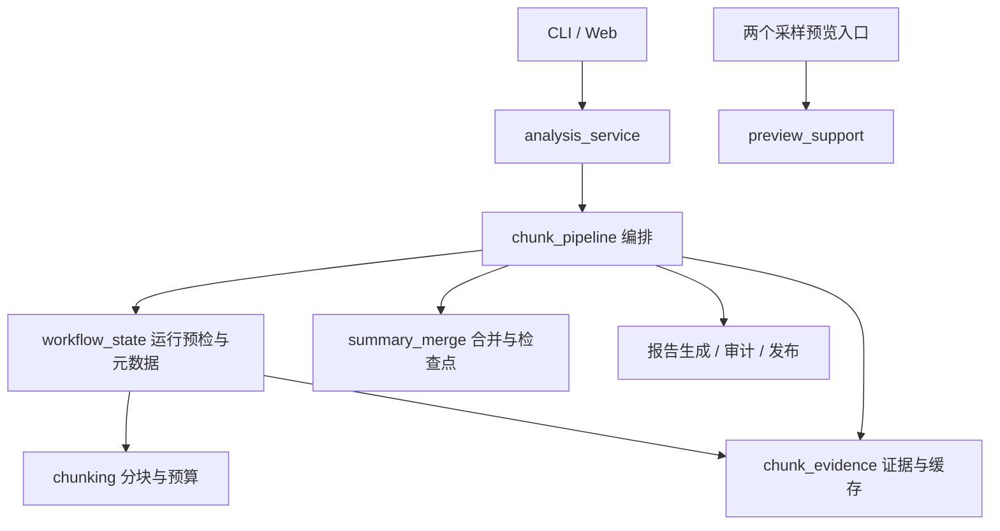

# 分块工作流结构优化

日期：2026-10-30。范围：完整工作流内部边界、采样预览公共逻辑、时间解析和 Web 进程异常处理。外部启动命令、CLI 参数、提示词、输出结构与脱敏规则保持原有约定。

## 架构与判断

优化后的依赖方向：

Opus 的意见中，最有价值的是对 `chunk_pipeline.py` 职责混杂和预览反向依赖的判断。裸字典、长函数或短入口本身不足以证明设计有问题；本次优先处理状态归属、隐藏知识、依赖方向和错误边界。

| 审查项 | 核查结论 | 已实施的处理 |
|---|---|---|
| 分块文件兼管证据格式、合并策略和文件布局 | 存在，维护者必须跨多个责任理解一次运行 | 提取三个模块，将运行布局/元数据收回 `workflow_state` |
| 运行参数与路径全靠无类型字典 | 内部契约不明确，确有改进空间 | 配置使用冻结 dataclass，产物/路径/清单使用 TypedDict |
| 预览入口互相导入 | 存在，人物预览依赖关系预览中的采样函数 | 共用 `preview_support`，同时共享懒生成的回退提示词策略 |
| 6 处生产代码路径注入 | 对现有直接运行脚本的方式是冗余的 | 删除；用独立解释器、合成工作区验证脚本入口 |
| 日期、月份、小时反复解析同一字符串 | 存在重复计算 | 共享最多 4096 项的时间文本解析缓存，不向消息加入不可序列化对象 |
| `parse_message` 重复分支 | 有内容的文本与其他类型返回结构相同；媒体分支另有占位语义 | 合并重复返回，保留图片/动画占位和系统消息排除 |
| Web 边界宽泛捕获 | 有必要防止事件异常遗留进程注册，但失败原因太笼统 | 保留任务边界，记录异常类型 `failure_kind`；重试前清除旧值 |

## 重要边界

`chunk_pipeline.py` 从 975 行缩至 205 行，只保留证据抽取执行、报告编排与受限重跑。原本 139 行的单次工作流降至 96 行，自动缩块函数从 68 行降至 36 行。拆分围绕责任归属；不要求每个函数都短于某个阈值。

`workflow_state.prepare_run()` 封装身份、保存参数、分区清单和缓存来源核对，返回 `PreparedRun`。在所有恢复预检通过前不改写已有运行的元数据与覆盖材料。它依赖分块/证据模块，低层模块不反向依赖编排器。坏缓存仍须重算编号和锚点，不能因为内部有类型提示就跳过校验。

`ChunkSettings` 汇总消息数、原文字节、提示词字节、请求超时和冷却设置，缩块产生新配置。自动重跑只捕获 `RetryableChunkStageFailure`，报告、审计、配置等其他失败直接传播。CLI 仍可分别调整这些具有不同用途的参数。

`AnalysisArtifacts`、`RunPaths` 和 `ChunkMetadata` 保留字典结构，以配合 JSON、产物审计与文件组发布。`TypedDict` 提供静态约定，不执行运行时校验，也不意味着所有字典已严格建模；外部聊天、模型输出、磁盘缓存和 HTTP 请求仍保留输入验证。

两个采样脚本继续只写 `analysis/预览/`；`run_analysis.py` 仍提供统计与按需采样提示词，`preview_prompts.py` 由共享预处理显式使用。它们不是无调用的死代码，也不是完整分析的兼容包装，因此保留。

暂不迁移成必须通过 `python -m agent.xxx` 启动的包：这会同时改动内部导入、子进程和已公开的命令，当前没有分发或库调用需求。移除冗余生产注入已解决本轮实际问题；测试启动时仍显式加入源码目录。`analyze.py` 保留既有脚本入口，格式识别和校验仍由输入适配模块负责；时间解析去重不需要改动这一公开名称。

`pass` 的核查结果：stderr 循环用于持续排空子进程输出；访问日志钩子避免输出本地路径；Ctrl+C 允许服务正常结束；非法 Retry-After 回到指数退避；进度流 flush 不把半行当作完整事件。保留这些明确语义，补充缺少的说明。

## 取舍与风险

- 只做局部命名和注释不能解除运行布局、证据格式与合并缓存的耦合；本次选择按所有权提取模块。
- 同时替换全部字典、合并全部入口和改变包运行方式，会放大迁移范围，因此未采用。已有文件格式和命令是需要保持的用户契约。
- 内部测试的替身改为作用于真正拥有函数调用的模块；不通过重新导出旧符号维持无必要的内部兼容层。
- 新运行模块加入流程指纹。旧版本缓存可能需要重新生成；显式续跑不兼容时拒绝，网页自动恢复保留原有跳过/新建策略，不声称透明迁移缓存。
- 运行文件布局与异常回滚沿用既有机制；本次没有新增断电事务或跨进程写锁。

## 验证

新增边界测试先复现缺少公共配置/预览模块、时间重复解析、新模块缺席流程指纹，以及 Web 失败缺少类型记录，再实现修正。独立脚本导入检查是迁移后的补充验证。

- 完整 Python 回归包含原有来源绑定、脱敏隔离、缓存拒绝、缩块恢复、网页 HTTP 及发布故障注入。
- Node 界面测试继续验证旧响应丢弃、安全文字渲染和原文高亮。
- 合成工作区中用独立解释器运行预处理入口和 CLI 帮助，预览脚本在无密钥时明确退出；没有依赖项目工作目录的隐式导入。
- 对迁移函数做 AST 对比：分块规则、覆盖、JSON 提取、提示词、摘要、账本及合并算法保留原结构。证据规范化在字段校验后直接读取已确认的五个列表。
- 不处理真实对话，不修改 `.env`，不发起付费模型请求；本地计划由 Git 忽略，一次性迁移脚本已清理。

下一项产品能力仍为 Phase 2 结论账本；本轮完成的是 Phase 4 的结构整理，不新增关系推断或量化评分。

最终验证：176 项 Python 测试（原有 168 项 + 8 项边界测试）与 5 项 Node 测试通过；Python/JavaScript 语法、UTF-8、BOM、换行、差异及文档链接检查通过。移动代码不触碰原提示词内容；已有混合换行文件仅在实际改动的区域变化，新模块使用 UTF-8/LF。

## 防御性编程复核

2026-10-30 再次检查 `agent/` 的异常处理、默认值和校验边界。结论：整体可接受，没有普遍堆叠无依据保护的情况；内部摘要中的缺字段默认值值得移除，已修正。

- **已修正（中）**：`analysis_artifacts.format_stats_summary` / `format_parse_diagnostics_report` 的输入来自本次预处理，必需字段缺失属于程序错误，不能替换成 0、空字典或 None。现在直接读取字段；没有某一发送方的计数仍合法，保留 `.get(sender, 0)`。
- **已修正（低）**：`call_llm_with_retry_result` 在最终失败时已直接抛出异常，循环外保存并再次抛出 `last_error` 的分支不可达，已删除。
- **通过：外部输入**。聊天适配、模型输出、HTTP 请求和持久化 JSON 需要类型、字段和枚举检查；磁盘缓存不能因来自本程序就永久信任。
- **通过：异常传播**。9 处 `except Exception` 分别承担请求错误分类后重抛、批次/子进程失败报告或脱敏后重抛；没有裸 `except:`。2 处 `BaseException` 位于文件发布回滚，清理后继续抛出，不吞掉中断。
- **通过：运行保护**。证据查询前后的版本核对针对并发变化；分块恢复预检与发布前审计保护不同契约，保留。
- **通过：空值语义**。缺少可计算回复间隔、没有某发送方计数、可选导出身份字段等都是真实的数据状态；保留对应 None/0/缺省行为。
- **通过：任务生命周期**。stderr 排空、日志抑制、Ctrl+C、进度流 flush 与 Retry-After 回退有明确作用；Web 事件失败记录异常类型并释放任务。

新增 2 项回归先复现缺字段被掩盖，再修正；验证总数为 178 项 Python 测试和 5 项 Node 测试。缓存解析测试清空自身缓存，避免不同测试共享同一合成日期而互相影响。该结论覆盖本次审查的主要调用链，未宣称完成形式化验证。
